id: hubspot-snowflake-round-trip-with-skyvia
categories: snowflake-site:taxonomy/solution-center/certification/quickstart, snowflake-site:taxonomy/solution-center/certification/partner-solution, snowflake-site:taxonomy/product/data-engineering, snowflake-site:taxonomy/snowflake-feature/ingestion, snowflake-site:taxonomy/snowflake-feature/connectors
language: en
summary: Replicate HubSpot data to Snowflake, build a customer segment in SQL and sync it back to HubSpot with reverse ETL in Skyvia.
environments: web
status: Published
feedback link: https://github.com/Snowflake-Labs/sfguides/issues
author: TODO Author Full Name


# HubSpot to Snowflake and Back: ELT and Reverse ETL with Skyvia
<!-- ------------------------ -->
## Overview

Customer data often lives in a CRM like HubSpot, while analysis happens in Snowflake, where it can be combined with billing, product usage and other sources. For that analysis to pay off, data has to move both ways. HubSpot data needs to reach Snowflake and stay up to date. The results, such as a customer segment or a score, need to go back to HubSpot, where sales and marketing teams use them in lists, filters and workflows.

These two directions are often handled separately: one tool or script loads data into the warehouse, and another one sends the results back. That means two setups to build, schedule and monitor.

In this quickstart, you build both directions in Skyvia, a managed cloud data integration platform. A simple customer segment serves as the example:

1. **Load.** Skyvia Replication loads HubSpot contacts, deals and their associations into Snowflake and keeps them up to date.
2. **Transform.** A SQL view in Snowflake labels each contact *High value* or *Standard* based on the total of their closed-won deals.
3. **Sync back.** Skyvia Import writes the label to a HubSpot contact property. This step is reverse ETL: data goes from the warehouse back to a business app.

Both integrations run on a daily schedule. The only code you write is the SQL for the segment.

To keep the example small, the segment uses only HubSpot deals. In a real project, the same setup works for any result you calculate in Snowflake, for example a churn risk score based on product usage and support tickets.

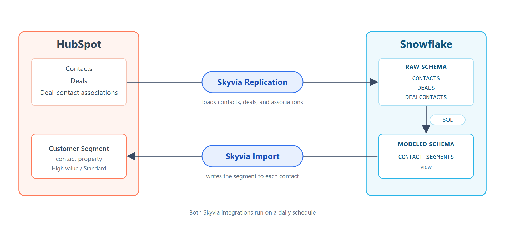

### Prerequisites

- Basic knowledge of SQL
- Familiarity with HubSpot contacts and deals

### What You'll Need

- A [Snowflake account](https://signup.snowflake.com/?utm_source=snowflake-devrel&utm_medium=developer-guides&utm_cta=developer-guides) or a free trial
- A [Skyvia account](https://app.skyvia.com/register?utm_source=snowflake_quickstart&utm_medium=referral&utm_campaign=snowflake_partnership). New accounts start with a free trial of the Professional plan, which covers everything in this guide.
- A new [free HubSpot account](https://www.hubspot.com/). Don't use your production CRM: the last steps write data to HubSpot contacts.
- The test data: two CSV files with fictional contacts and deals ([download from GitHub](https://github.com/yevhenii-skyvia/snowflake-test-data))

### What You'll Learn

- How to connect Skyvia to Snowflake with a programmatic access token and to HubSpot with OAuth
- How to replicate HubSpot objects to Snowflake
- How to build a customer segment as a SQL view
- How to sync the segment back to HubSpot with reverse ETL
- How to schedule both integrations

### What You'll Build

- A daily pipeline that keeps a *Customer Segment* property in HubSpot up to date with a segment calculated in Snowflake

<!-- ------------------------ -->
## Set Up Your Accounts

This guide uses three accounts: Snowflake, HubSpot, and Skyvia. If you already have them, skip to the next section.

### Create a HubSpot Account

Create a new HubSpot account even if you already have one. The last steps of this guide write data to HubSpot, so a separate account keeps your real CRM data safe.

1. Sign up for a [free HubSpot account](https://www.hubspot.com/) with your email address.
2. Confirm your email address and follow the setup wizard steps. 
3. If the wizard offers to create a deal pipeline, click **Continue without a pipeline**. This guide uses the default Sales Pipeline.

### Create a Snowflake Trial Account

1. Fill out the [Snowflake trial form](https://signup.snowflake.com/?utm_source=snowflake-devrel&utm_medium=developer-guides&utm_cta=developer-guides). Use an email address that isn't associated with an existing Snowflake account.
2. Select any edition, cloud provider, and region. They don't affect this guide.
3. Open the activation email from Snowflake and finish setting up your account.
4. Save the account URL from the email. You need it later to connect Skyvia to Snowflake.

### Create a Skyvia Account

1. Sign up for a [Skyvia account](https://app.skyvia.com/register?utm_source=snowflake_quickstart&utm_medium=referral&utm_campaign=snowflake_partnership).
2. Confirm your email address and sign in.
3. Complete the setup wizard:
   - On the **About You** page, enter your details.
   - On the **Your Role** page, select any suitable role.
   - On the **Your Goals** page, select **I'm just checking out the product** and click **Continue**.
   - On the **Choose how to start your journey** page, select **I'm ready** and click **Continue**.

   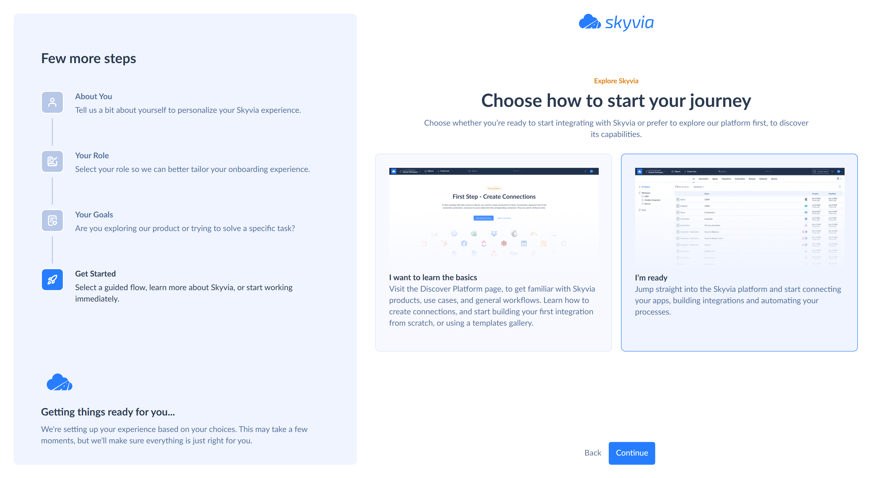

A new Skyvia account starts with a free trial of the Professional plan, which covers everything in this guide.

<!-- ------------------------ -->
## Prepare Snowflake

Run the setup script below to prepare Snowflake for Skyvia. It creates:

- The `SKYVIA_WH` warehouse
- The `HUBSPOT_DEMO` database with two schemas: `RAW` for the data Skyvia loads from HubSpot, and `MODELED` for the segment you build with SQL
- The `SKYVIA_ROLE` role that Skyvia uses to work with these objects
- The `SKYVIA_USER` service user that Skyvia signs in as, with a network policy that allows connections only from Skyvia's IP addresses
- A programmatic access token (PAT) for `SKYVIA_USER`

1. In Snowsight, go to **Projects** > **Workspaces** and click **SQL file**.

   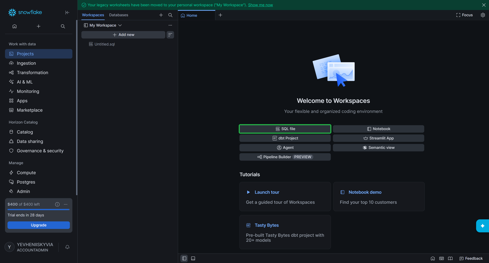
2. Paste the following script: 

   ```sql
   USE ROLE ACCOUNTADMIN;
   
   -- Warehouse for Skyvia loads and your queries
   CREATE WAREHOUSE IF NOT EXISTS SKYVIA_WH
     WAREHOUSE_SIZE = XSMALL
     AUTO_SUSPEND = 60
     AUTO_RESUME = TRUE
     INITIALLY_SUSPENDED = TRUE;
   
   -- Database for loaded and modeled data
   CREATE DATABASE IF NOT EXISTS HUBSPOT_DEMO;
   CREATE SCHEMA IF NOT EXISTS HUBSPOT_DEMO.RAW;
   CREATE SCHEMA IF NOT EXISTS HUBSPOT_DEMO.MODELED;
   
   -- Role for Skyvia
   CREATE ROLE IF NOT EXISTS SKYVIA_ROLE;
   GRANT ROLE SKYVIA_ROLE TO ROLE SYSADMIN;
   
   GRANT USAGE ON WAREHOUSE SKYVIA_WH TO ROLE SKYVIA_ROLE;
   GRANT USAGE ON DATABASE HUBSPOT_DEMO TO ROLE SKYVIA_ROLE;
   GRANT USAGE, CREATE TABLE, CREATE STAGE, CREATE FILE FORMAT
     ON SCHEMA HUBSPOT_DEMO.RAW TO ROLE SKYVIA_ROLE;
   GRANT USAGE ON SCHEMA HUBSPOT_DEMO.MODELED TO ROLE SKYVIA_ROLE;
   GRANT SELECT ON FUTURE VIEWS IN SCHEMA HUBSPOT_DEMO.MODELED TO ROLE SKYVIA_ROLE;
   
   -- Network policy that allows connections only from Skyvia's IP addresses
   CREATE NETWORK POLICY IF NOT EXISTS SKYVIA_POLICY
     ALLOWED_IP_LIST = ('40.118.246.204', '13.86.253.112', '52.190.252.0');
   
   -- Service user for Skyvia
   CREATE USER IF NOT EXISTS SKYVIA_USER
     TYPE = SERVICE
     DEFAULT_ROLE = SKYVIA_ROLE
     DEFAULT_WAREHOUSE = SKYVIA_WH
     NETWORK_POLICY = SKYVIA_POLICY;
   GRANT ROLE SKYVIA_ROLE TO USER SKYVIA_USER;
   
   -- Programmatic access token for the Skyvia connection
   ALTER USER SKYVIA_USER ADD PROGRAMMATIC ACCESS TOKEN SKYVIA_PAT
     ROLE_RESTRICTION = 'SKYVIA_ROLE'
     DAYS_TO_EXPIRY = 90;
   ```

3. Click the arrow next to the **Run** button and select **Run all**, or press **Ctrl+Shift+Enter**.

   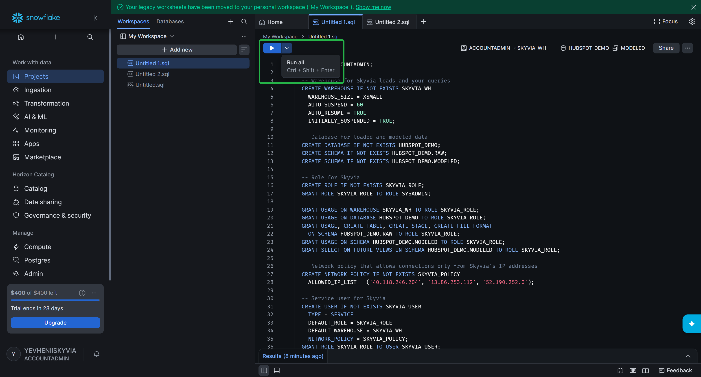

4. Copy the `token_secret` value from the result of the last statement. You need it in the next step. Snowflake displays the token only once.

   The token expires in 90 days. To get a new one, run `ALTER USER SKYVIA_USER ROTATE PROGRAMMATIC ACCESS TOKEN SKYVIA_PAT;` and update the token in the Skyvia connection.

<!-- ------------------------ -->
## Connect Skyvia

A connection stores credentials and settings that Skyvia needs to access a data source. You create a connection once and then reuse it in any integration that works with that data source.

Create two connections, one to Snowflake and one to HubSpot. The integrations in the next steps use them to read and write data.

### Create a Snowflake Connection

1. In Skyvia, click **+ Create New** and select **Connection**.

   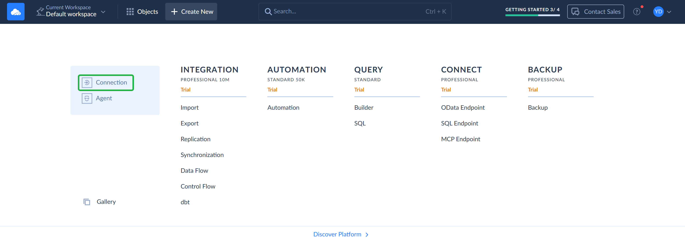

2. Find and select **Snowflake**.
3. Specify the connection parameters:
   - **Domain**: your Snowflake account URL, for example, `https://<account_identifier>.snowflakecomputing.com`
   - **Authentication**: *Programmatic Access Token*
   - **User**: `SKYVIA_USER`
   - **PAT**: the token you copied in the previous step
   - **Database**: `HUBSPOT_DEMO`
   - **Warehouse**: `SKYVIA_WH`
   - **Schema**: `RAW`
   - **Role**: `SKYVIA_ROLE`

   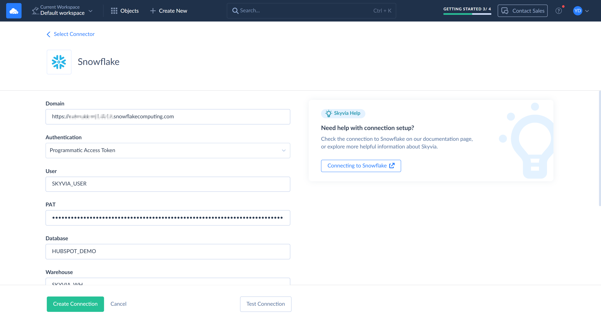

4. In **File Storage for Bulk**, select *Internal*.
5. Click **Test Connection** to check that Skyvia can connect to Snowflake.
6. Click **Create Connection**.

### Create a HubSpot Connection

1. Click **+ Create New** and select **Connection**.
2. Find and select **HubSpot**.
3. Click **Sign In with HubSpot** and log in to the HubSpot account you created for this guide.
4. Select the account and click **Choose Account**.
5. Scroll to the bottom of the permission page, select the checkbox, and click **Connect app**. Skyvia fills in the **Access Token** field.

   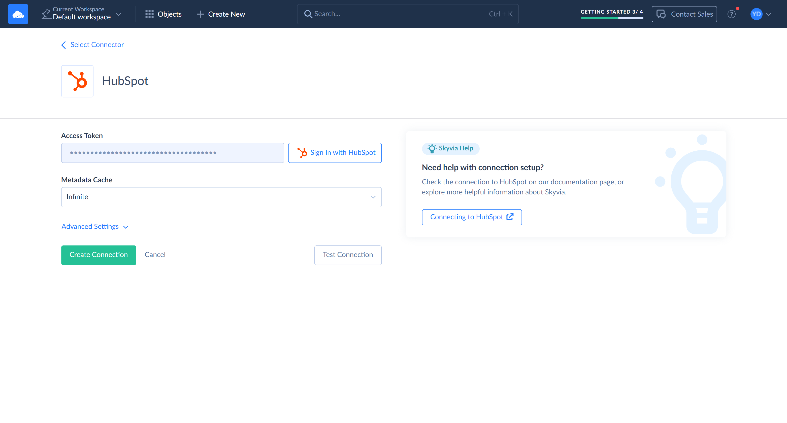

6. Click **Test Connection** to check that Skyvia can connect to HubSpot.
7. Click **Create Connection**.

<!-- ------------------------ -->
## Load Test Data

In Skyvia, integrations perform different jobs on data. Import is an integration that loads data from CSV files, databases, or cloud apps into a target. Import consists of tasks, where each task reads one source, writes to one target object, and maps the source columns to the target fields.

Load sample contacts and deals into HubSpot using Skyvia import. The test data consists of two CSV files:

- [contacts.csv](https://raw.githubusercontent.com/yevhenii-skyvia/snowflake-test-data/main/contacts.csv) with 100 fictional contacts
- [deals.csv](https://raw.githubusercontent.com/yevhenii-skyvia/snowflake-test-data/main/deals.csv) with 100 deals, each linked to a contact by email address

Download both files before you start. You can also load them with the HubSpot import tool instead of Skyvia.

### Create the Import

1. Click **+ Create New** and select **Import** under **Integration**.
2. Click the default *Untitled* name and rename the import, for example, to *Load HubSpot test data*.
3. Under **Source Type**, keep **CSV upload manually** selected.
4. Under **Target**, select your HubSpot connection in the **Connection** list.
5. Under **Options**, select the **Preserve task order** checkbox. The last task links deals to contacts, so both must be loaded before it runs.

   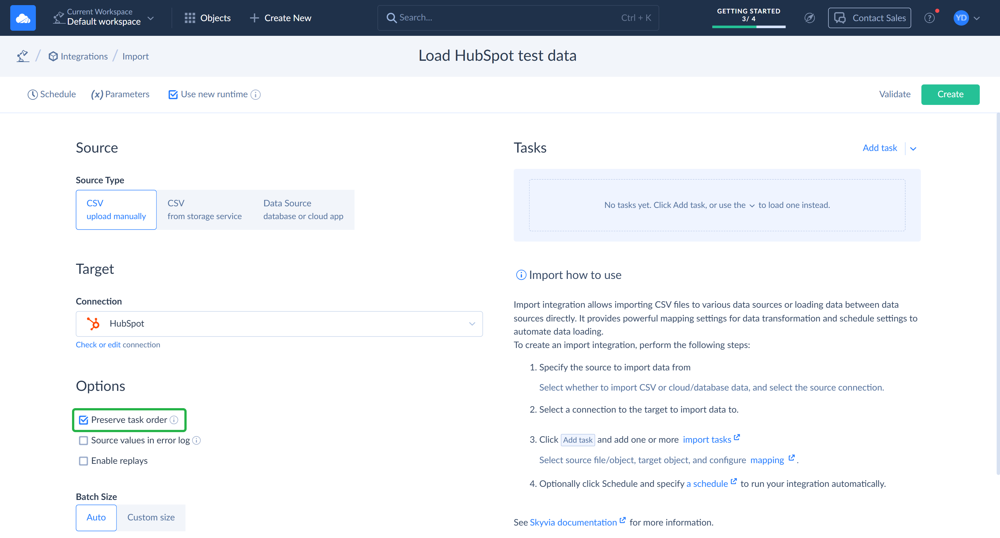

### Add the Contacts Task

1. Click **Add task**.

   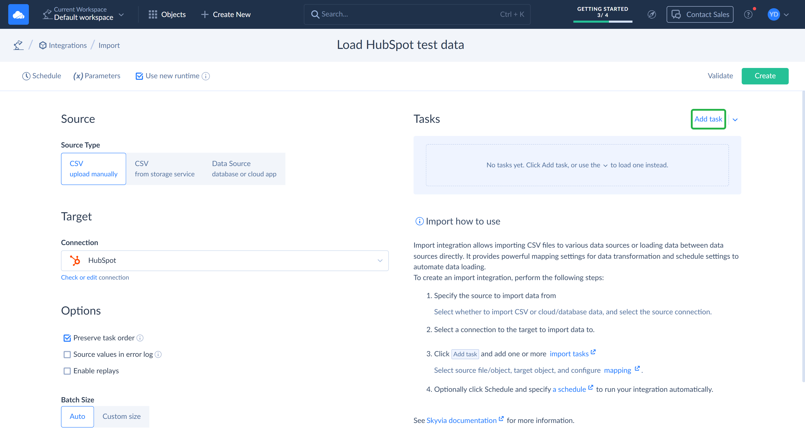

2. Drag *contacts.csv* to the **Upload CSV file** area, or click **browse** and select the file.

   

3. Click **Target definition**. In the **Target** list, select *Contacts* and keep the **Insert** operation.

   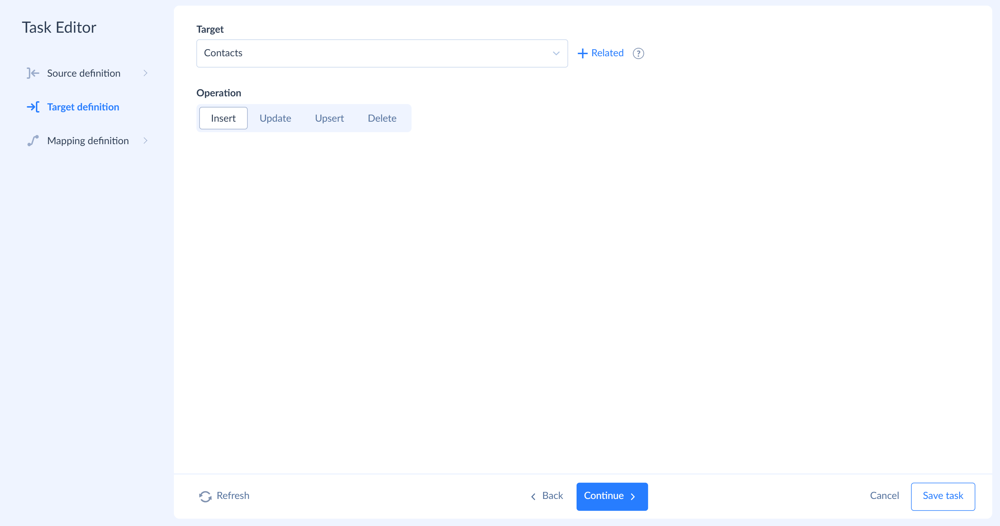

4. Click **Mapping definition** and check that all CSV columns are mapped. Mapping defines which source column fills each target field. The columns have the same names as the HubSpot fields, so Skyvia maps them automatically.

   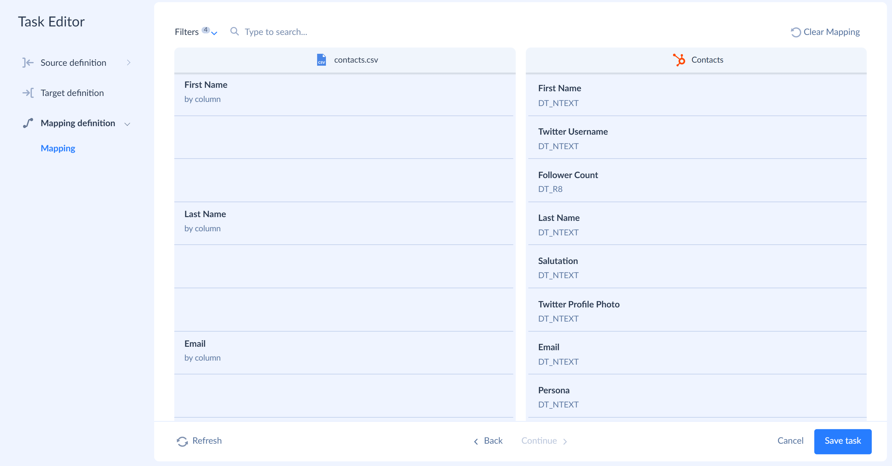

5. Click **Save task**.

### Add the Deals Task

1. Click **Add task**.
2. Drag *deals.csv* to the **Upload CSV file** area, or click **browse** and select the file.

   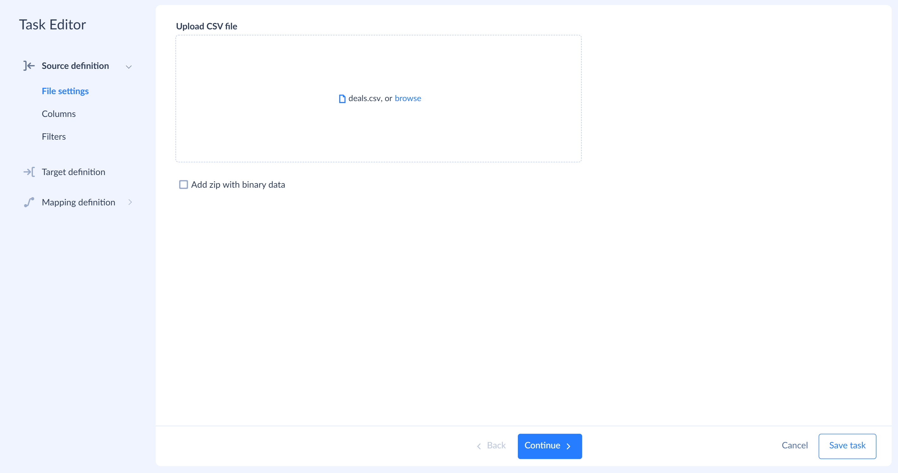

3. Click **Target definition**. In the **Target** list, select *Deals* and keep the **Insert** operation.

   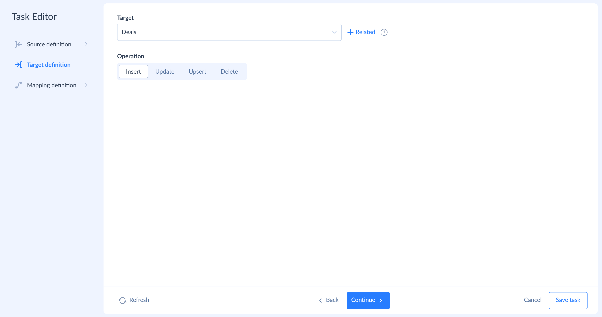

4. Click **Mapping definition** and check that the *Deal Name*, *Amount*, *Deal Stage*, *Pipeline*, and *Close Date* columns are mapped automatically.

   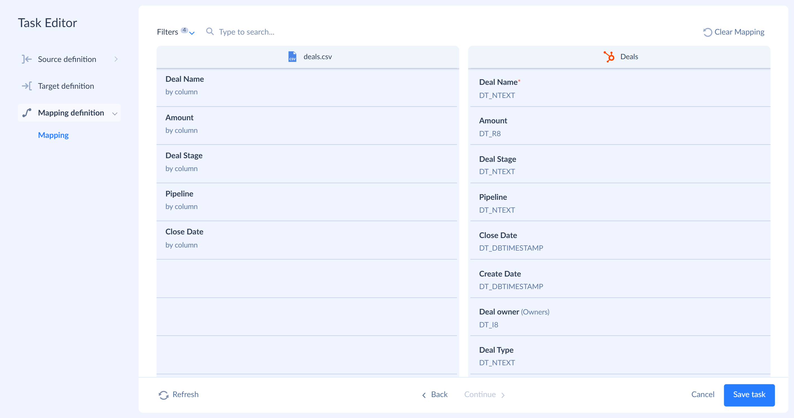

5. Click **Save task**.

### Link Deals to Contacts

In HubSpot, a deal is linked to a contact through an association. Skyvia shows deal-contact associations as the *DealContacts* object, where each record is a pair of a deal ID and a contact ID. This task creates these records. It finds each deal by its name and each contact by its email address.

1. Click **Add task**.
2. Upload *deals.csv* to the **Upload CSV file** area again. Skyvia renames the second copy to *deals1.csv*.

   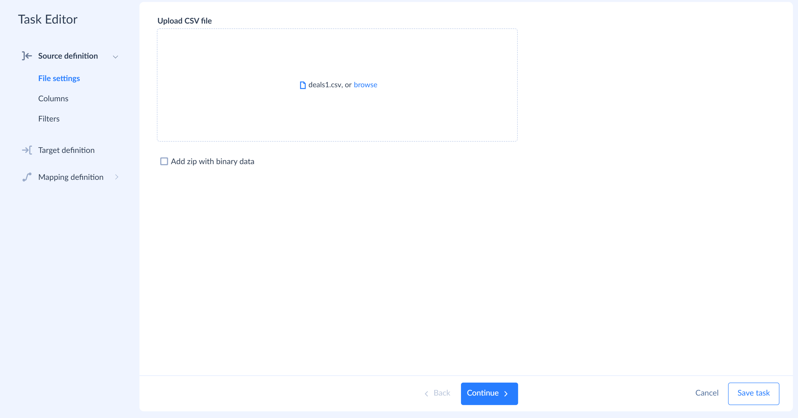

3. Click **Target definition**. In the **Target** list, select *DealContacts* and keep the **Insert** operation.

   

4. Click **Mapping definition**. The file has no HubSpot IDs, so get them with a target lookup: it finds a record in HubSpot by a value from the file and returns that record's ID. Click the *Deal ID* column and select **Target Lookup**. Then specify the lookup:
   - **Lookup Object**: *Deals*
   - **Result Column**: *Id*
   - Under **Lookup Key Column**, select *Deal Name*. Keep **Column** and select the *Deal Name* column of the file.
5. Click the *Contact ID* column and select **Target Lookup**. Then specify the lookup:
   - **Lookup Object**: *Contacts*
   - **Result Column**: *Id*
   - Under **Lookup Key Column**, select *Email*. Keep **Column** and select the *Contact Email* column of the file.

   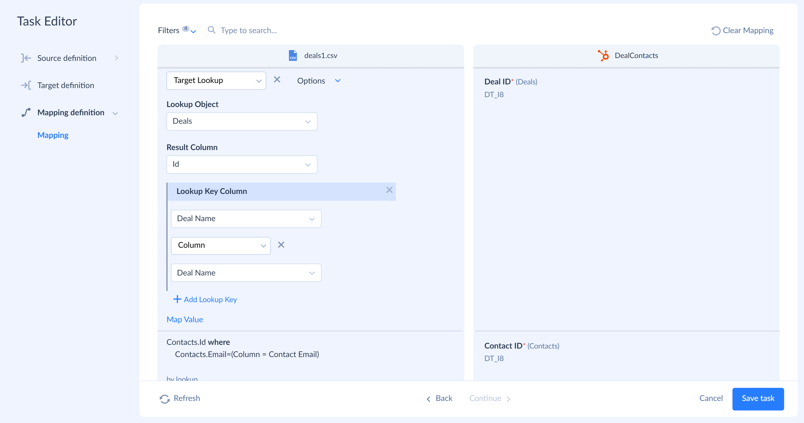

6. Click **Save task**.

### Run the Import

The import now has three tasks. Because **Preserve task order** is on, Skyvia runs them from top to bottom, so contacts and deals are added before the link task looks them up.

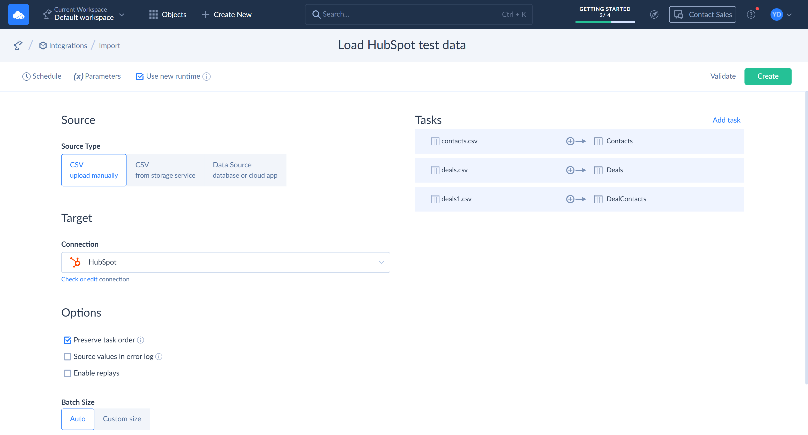

1. Click **Create** to save the import.
2. Click **Run**.
3. When the run completes, open the **Monitor** tab. It lists every run of the integration with the number of successfully processed and failed rows. Click the run in **Run history** to see the results for each task. Each task should show 100 success rows and 0 error rows.

   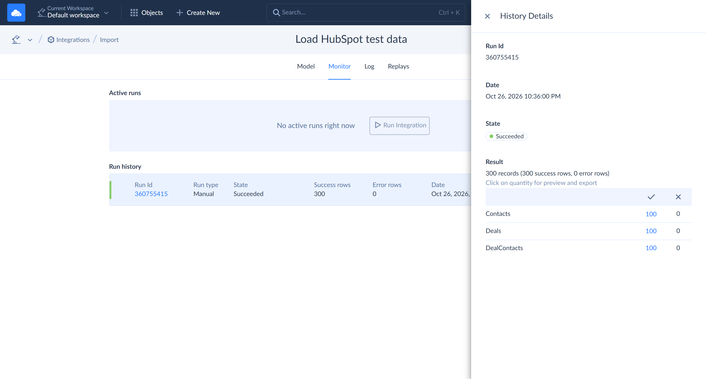

<!-- ------------------------ -->
## Replicate HubSpot Data

A replication copies HubSpot objects to Snowflake and creates the tables for them. The first run loads all records. Later runs load only the records that changed since the previous run.

### Create the Replication

1. Click **+ Create New** in the top menu and select **Replication**. The replication wizard opens.

   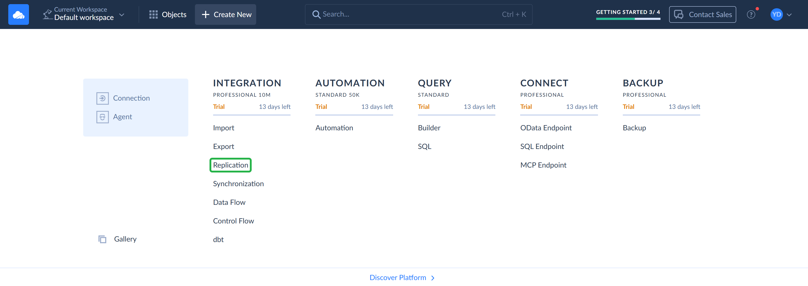

2. On the **Source setup** step, select the *HubSpot* connection and click **Continue**.

   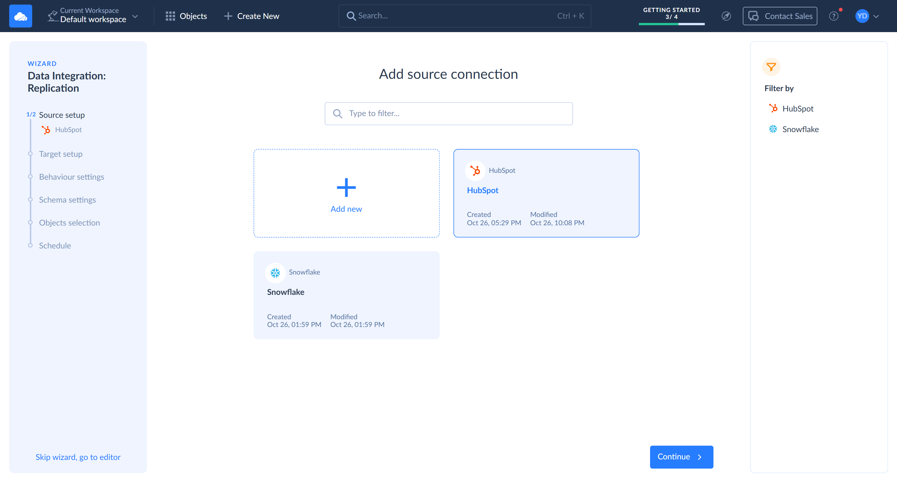

3. On the **Target setup** step, select the *Snowflake* connection and click **Continue**.

   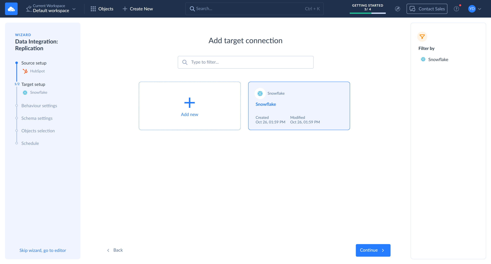

4. On the **Behaviour settings** step, keep the default settings. With **Incremental Updates**, later runs load only the changes. With **Create new**, Skyvia creates the tables in the `RAW` schema for you. When **Apply changes** is selected, Skyvia adds new HubSpot fields to these tables when they appear. Click **Continue**.

   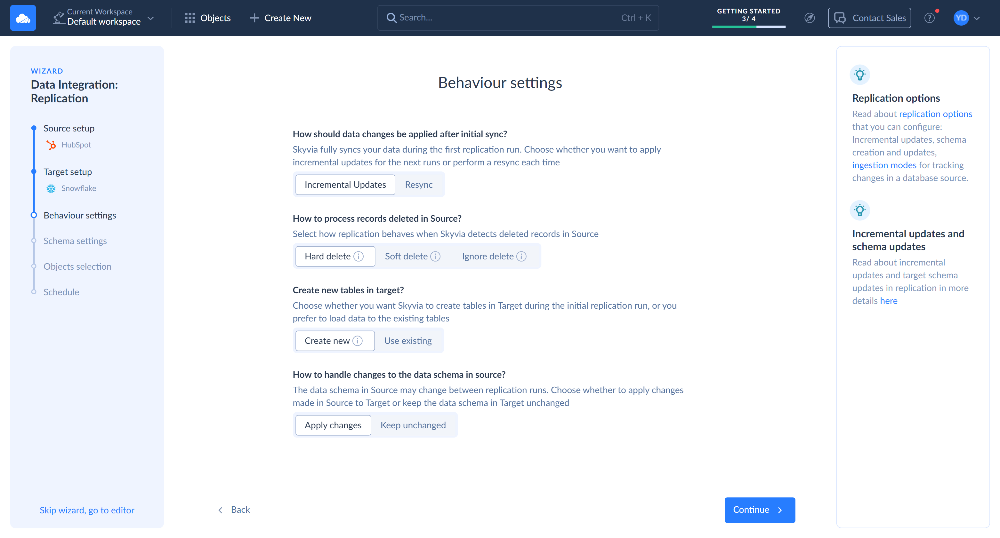

5. On the **Schema settings** step, set **Case** to **Upper** and select **Sanitize Table/Column Names**. With these settings, Skyvia creates upper-case table names, such as `DEALS`, that you can query without quotes. In column names, it replaces spaces with underscores but keeps the case, so the *Deal Name* field becomes the `"Deal_Name"` column. In SQL, put column names in double quotes. Click **Continue**.

   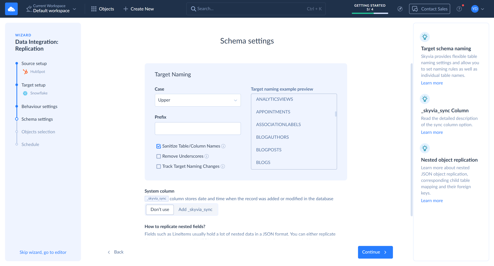

6. On the **Objects selection** step, select *Contacts*, *Deals*, and *DealContacts*. Use the search box to find them. Click **Continue**.

   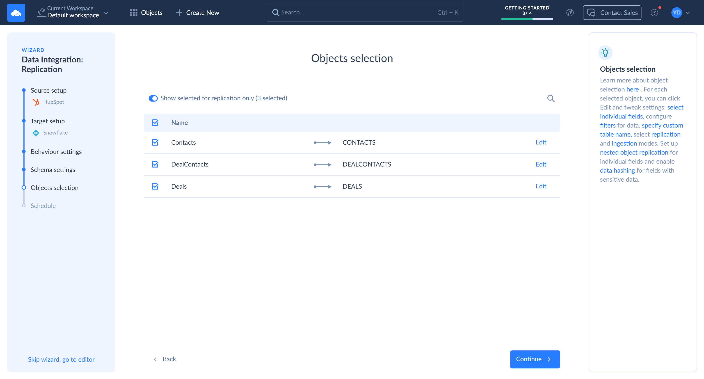

7. On the **Schedule** step, keep **No** for now. You schedule it together with the import at the end of this guide.

   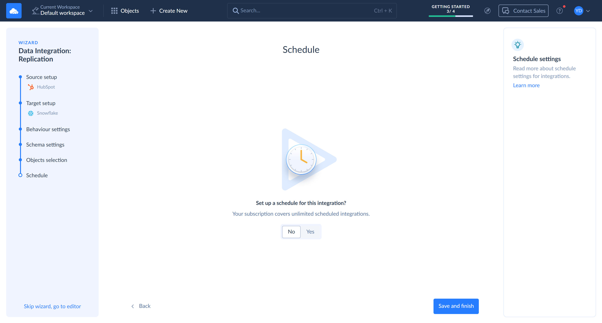

8. Click **Save and finish**. Skyvia saves the replication and opens it.
9. Click the default *Untitled* name and rename the replication, for example, to *Replicate HubSpot to Snowflake*.

### Run the Replication

1. Click **Run**.
2. When the run completes, open the **Monitor** tab and click the run in **Run history**. *DEALS* and *DEALCONTACTS* show 100 records each. *CONTACTS* shows 102, because HubSpot adds two sample contacts to every new account.

   

3. In Snowsight, go to **Catalog** > **Explorer** and expand *HUBSPOT_DEMO* > *RAW*. Check that the *CONTACTS*, *DEALCONTACTS*, and *DEALS* tables are there.

   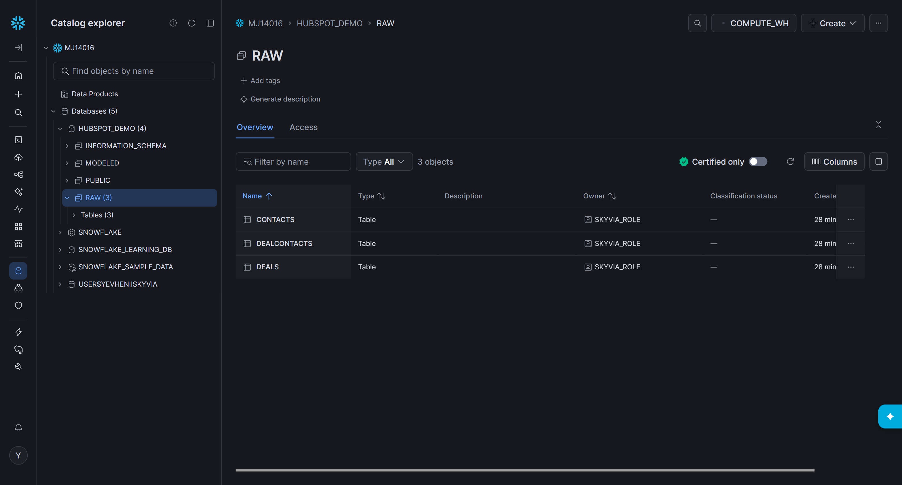

<!-- ------------------------ -->
## Build the Segment

A segment is a group of customers that share a trait. In this guide, each contact gets one of two labels:

- *High value*: the contact's closed-won deals add up to 50,000 or more
- *Standard*: all other contacts, including contacts without deals

You build the segment as a view in the `MODELED` schema. The view joins contacts to their deals through `DEALCONTACTS`, adds up the amounts of closed-won deals for each contact, and assigns the label. Because it's a view, it always shows the current data: each replication run updates the segment automatically.

1. In Snowsight, go to **Projects** > **Workspaces** and click **SQL file**.
2. Paste the following script:

   ```sql
   USE ROLE ACCOUNTADMIN;
   USE WAREHOUSE SKYVIA_WH;

   CREATE OR REPLACE VIEW HUBSPOT_DEMO.MODELED.CONTACT_SEGMENTS AS
   WITH won AS (
       SELECT
           c."Id" AS contact_id,
           c."Email" AS email,
           COALESCE(SUM(IFF(d."Is_Closed_Won", d."Amount", 0)), 0) AS closed_won_amount
       FROM HUBSPOT_DEMO.RAW.CONTACTS c
       LEFT JOIN HUBSPOT_DEMO.RAW.DEALCONTACTS dc ON dc."Contact_ID" = c."Id"
       LEFT JOIN HUBSPOT_DEMO.RAW.DEALS d ON d."Id" = dc."Deal_ID"
       GROUP BY c."Id", c."Email"
   )
   SELECT
       contact_id,
       email,
       closed_won_amount,
       IFF(closed_won_amount >= 50000, 'High value', 'Standard') AS segment
   FROM won;

   SELECT segment, COUNT(*) AS contacts
   FROM HUBSPOT_DEMO.MODELED.CONTACT_SEGMENTS
   GROUP BY segment;
   ```

   Column names from the replicated tables are in double quotes because Skyvia keeps their case. The view's own columns have no quotes, so Snowflake stores them in upper case: `CONTACT_ID`, `EMAIL`, `CLOSED_WON_AMOUNT`, and `SEGMENT`.

3. Click the arrow next to the **Run** button and select **Run all**, or press **Ctrl+Shift+Enter**.
4. Check the result of the last statement. With the test data, 21 contacts are *High value* and 81 are *Standard*. The *Standard* count includes the two sample contacts that HubSpot adds to new accounts.

   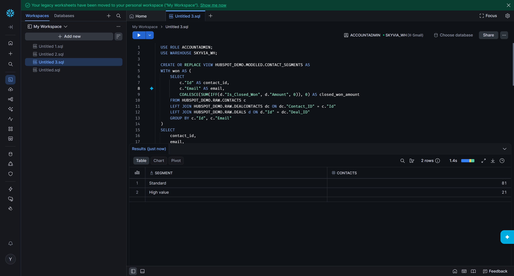

<!-- ------------------------ -->
## Sync Segment to HubSpot

Now write the segment back to HubSpot with reverse ETL, so that sales and marketing teams can filter contacts by it. First, create a contact property for the segment. Then create an import that reads the `CONTACT_SEGMENTS` view and updates HubSpot contacts.

### Create the Segment Property

1. In HubSpot, click the **Settings** icon in the top navigation bar.

   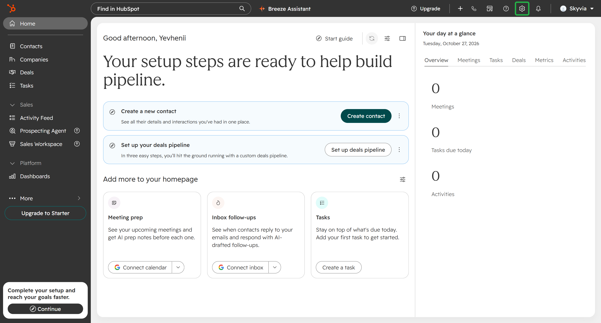

2. In the left menu, go to **Data Management** > **Properties**.
3. Make sure that *Contact properties* is selected in the **Select an object** list and click **Create property**.

   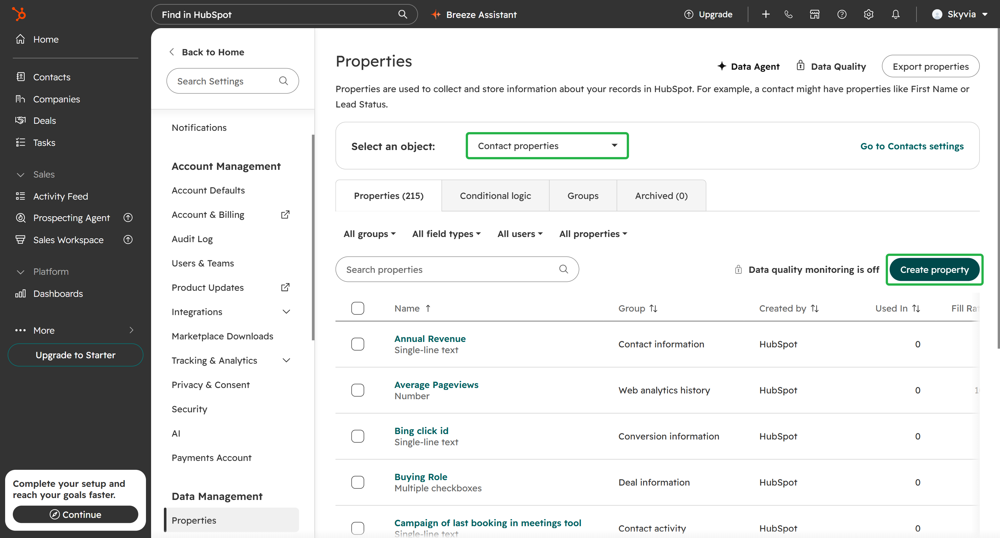

4. In the **Property label** box, enter *Customer Segment*. In the **Field type** list, select **Single-line text**.

   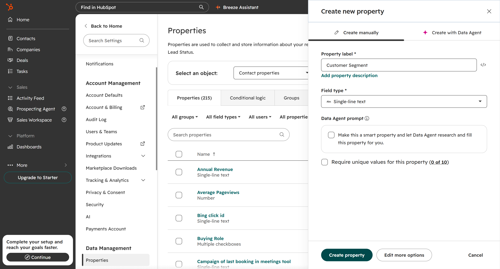

5. Click **Create property**.

### Create the Import

Switch back to Skyvia and create an import that reads the segment from Snowflake and writes it to HubSpot.

1. Click **+ Create New** in the top menu and select **Import**.

   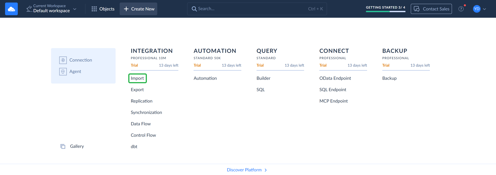

2. Click the default *Untitled* name and rename the import, for example, to *Sync segment to HubSpot*.
3. Under **Source Type**, click **Data Source**. In the **Connection** list, select the *Snowflake* connection.
4. Under **Target**, in the **Connection** list, select the *HubSpot* connection.

   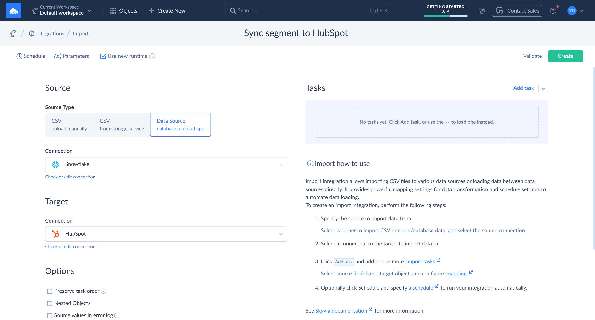

### Add the Segment Task

The Snowflake connection points to the `RAW` schema, and the view is in `MODELED`. To read the view, query it with SQL in the **Advanced** editor mode.

1. Click **Add task**.
2. Under **Editor Mode**, click **Advanced**. In the **Actions** list, select **Execute Command**.
3. In the **Command Text** box, enter the following command:

   ```sql
   SELECT CONTACT_ID, SEGMENT FROM HUBSPOT_DEMO.MODELED.CONTACT_SEGMENTS
   ```

   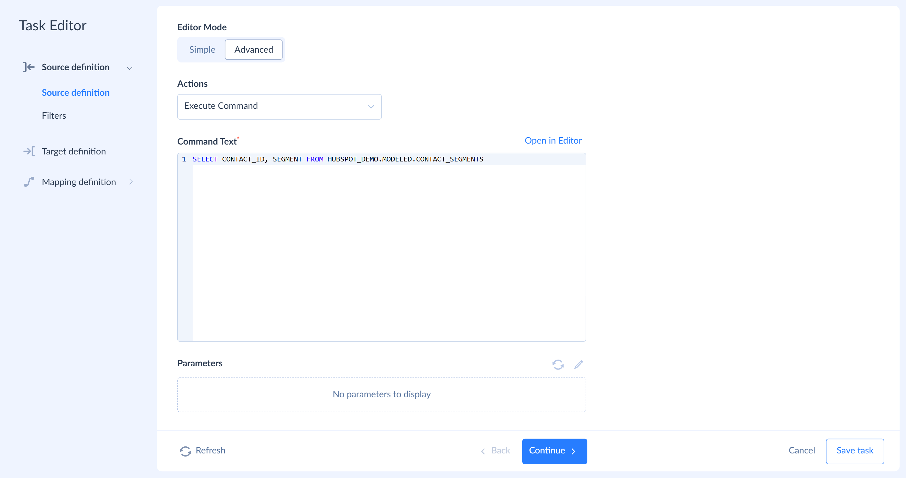

4. Click **Target definition**. In the **Target** list, select *Contacts* and click **Update**. For **Update type**, keep **Match by Primary Key**: the view returns the HubSpot contact IDs, so Skyvia finds each contact without additional setup.

   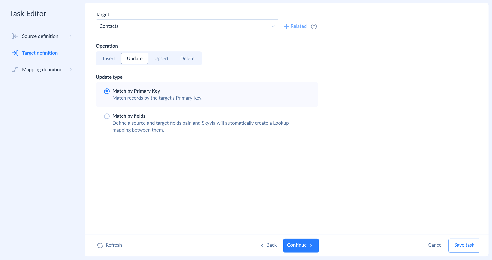

5. Click **Mapping definition**. Click the *Id* column, select **Column**, and select `CONTACT_ID`. Then map the *Customer Segment* column to `SEGMENT` the same way. If *Customer Segment* isn't in the list, click **Refresh** to reload the HubSpot fields.

   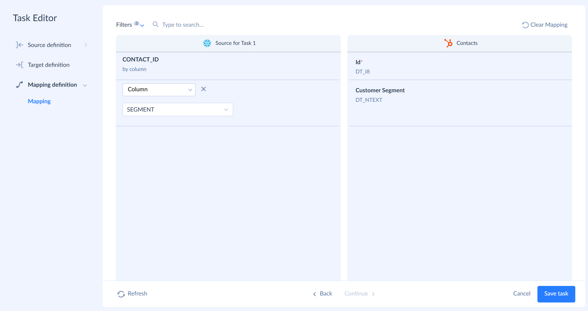

6. Click **Save task**.

### Run the Import

1. Click **Create** to save the import.

   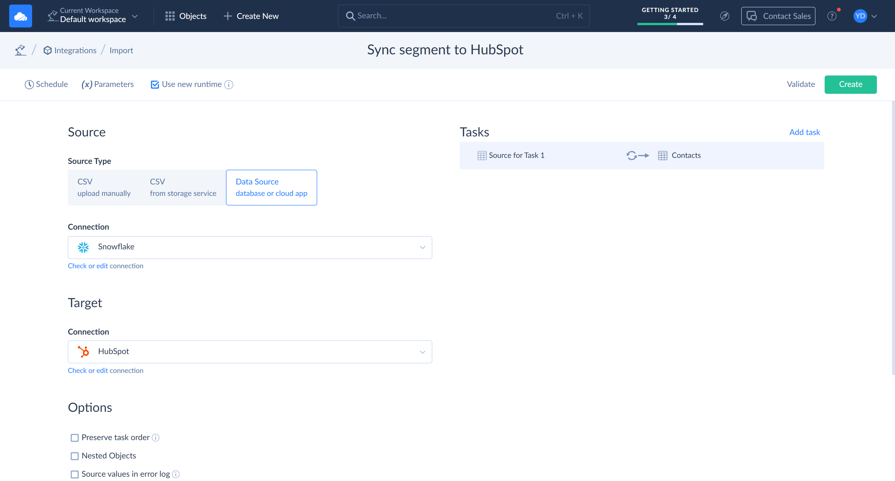

2. Click **Run**.
3. When the run completes, open the **Monitor** tab. The run in **Run history** shows 102 success rows and 0 error rows.

   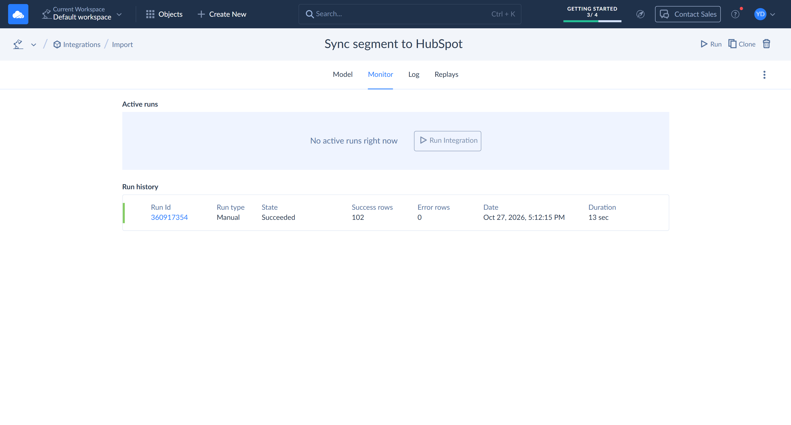

4. In HubSpot, click **Contacts** in the left menu. Next to the quick filters above the table, click **+** and add *Customer Segment*.
5. Click the **Customer Segment** filter. Keep **is equal to any of**, type *High value* in the **Add values** box, and press **Enter**. The table shows the 21 high-value contacts.

   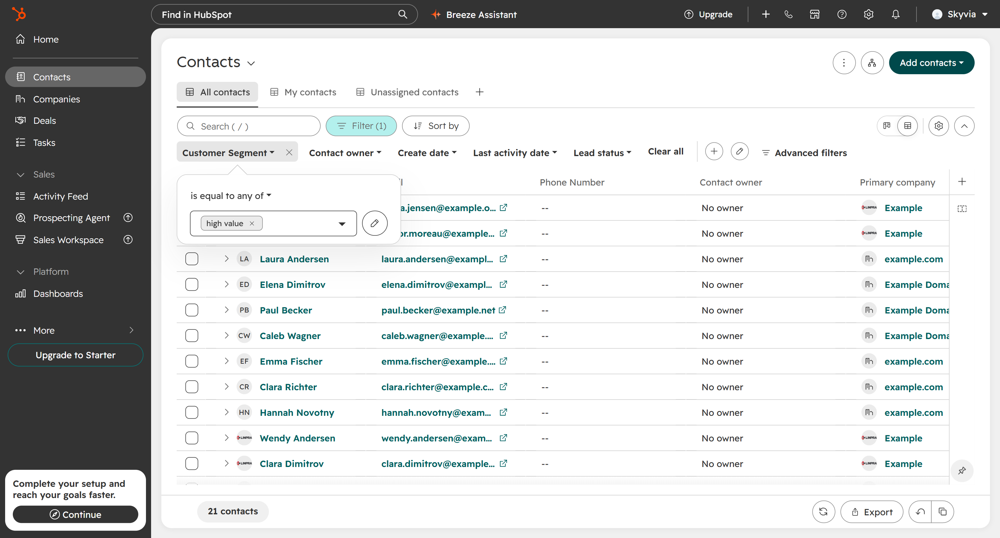

<!-- ------------------------ -->
## Schedule Both Integrations

So far, you've run both integrations manually. To keep the segment up to date as deals change in HubSpot, schedule integrations to run every day. The replication loads the changes to Snowflake, the view recalculates the segment, and the import writes the new labels back to HubSpot.

The import reads data that the replication loads, so schedule it to start after the replication. With the test data, the replication takes about a minute, so a 30-minute gap is enough.

### Schedule the Replication

1. Open the *Replicate HubSpot to Snowflake* replication and click **Schedule**.
2. Under **State**, keep **Enabled**. Under **Recurrence**, click **Recurring**. Under **Run every**, keep **Day**.
3. Under **Time**, keep **Occur once at** and enter *06:00*.
4. Under **Starting**, keep **Now** and select your **Time Zone**.

   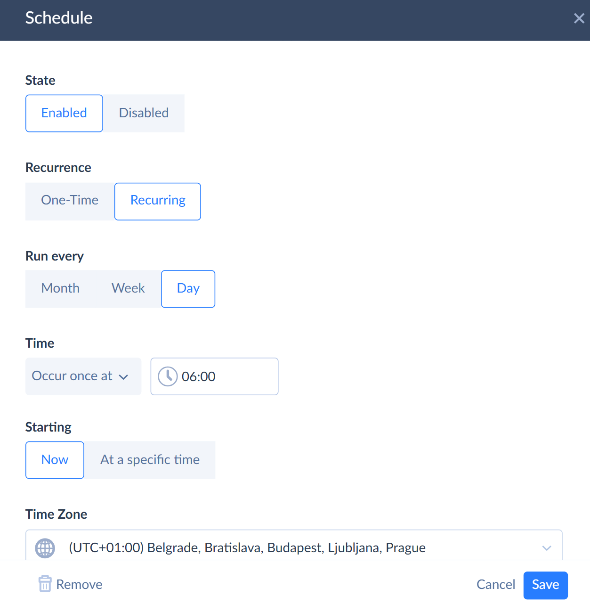

5. Click **Save** in the **Schedule** window, and then click **Save** in the replication editor.

### Schedule the Import

1. Open the *Sync segment to HubSpot* import and click **Schedule**.
2. Set the same daily schedule, but enter *06:30* under **Occur once at**.
3. Click **Save** in the **Schedule** window, and then click **Save** in the import editor.

<!-- ------------------------ -->
## Clean Up Resources

When you no longer need the setup, disable the schedules and remove the Snowflake objects that this guide created.

1. In Skyvia, open the replication and click **Schedule**. Under **State**, click **Disabled**, click **Save** in the **Schedule** window, and then click **Save** in the replication editor.
2. Do the same for the import.
3. In Snowflake, run the following script:

   ```sql
   USE ROLE ACCOUNTADMIN;
   DROP USER IF EXISTS SKYVIA_USER;
   DROP NETWORK POLICY IF EXISTS SKYVIA_POLICY;
   DROP DATABASE IF EXISTS HUBSPOT_DEMO;
   DROP WAREHOUSE IF EXISTS SKYVIA_WH;
   DROP ROLE IF EXISTS SKYVIA_ROLE;
   ```

<!-- ------------------------ -->
## Conclusion And Resources

You've built a round trip between HubSpot and Snowflake. Skyvia replicates HubSpot contacts, deals, and their associations to Snowflake, a SQL view assigns each contact a segment, and a Skyvia import writes the segment back to HubSpot every day. You built both directions in one platform, and the only code you wrote was the segment SQL.

You can extend this setup in several ways:

- Add more objects to the replication, such as *Companies*, and build segments for them.
- Run the replication and the import as one [control flow](https://docs.skyvia.com/data-integration/control-flow/?utm_source=snowflake_quickstart&utm_medium=referral&utm_campaign=snowflake_partnership) so that the import starts right after the replication finishes.
- Move the segment SQL to a dbt project and run it with [dbt in Skyvia](https://docs.skyvia.com/data-integration/dbt-transformation/?utm_source=snowflake_quickstart&utm_medium=referral&utm_campaign=snowflake_partnership) when your models grow.

### What You Learned

- How to connect Skyvia to Snowflake with a programmatic access token and to HubSpot with OAuth
- How to load test data to HubSpot with a Skyvia import
- How to replicate HubSpot objects to Snowflake with the replication wizard
- How to build a customer segment in Snowflake with a SQL view
- How to import the segment back to a HubSpot contact property
- How to schedule both integrations to keep the data in sync

### Related Resources

- [HubSpot and Snowflake Integration with Skyvia](https://skyvia.com/data-integration/integrate-hubspot-snowflake?utm_source=snowflake_quickstart&utm_medium=referral&utm_campaign=snowflake_partnership)
- [Skyvia Replication](https://docs.skyvia.com/data-integration/replication/?utm_source=snowflake_quickstart&utm_medium=referral&utm_campaign=snowflake_partnership)
- [Skyvia Import](https://docs.skyvia.com/data-integration/import/?utm_source=snowflake_quickstart&utm_medium=referral&utm_campaign=snowflake_partnership)
- [Scheduling Integrations in Skyvia](https://docs.skyvia.com/data-integration/scheduling-integrations-for-automatic-execution.html?utm_source=snowflake_quickstart&utm_medium=referral&utm_campaign=snowflake_partnership)
- [Skyvia HubSpot Connector](https://docs.skyvia.com/connectors/cloud-sources/hubspot_connections.html?utm_source=snowflake_quickstart&utm_medium=referral&utm_campaign=snowflake_partnership)
- [Skyvia Snowflake Connector](https://docs.skyvia.com/connectors/databases/snowflake_connections.html?utm_source=snowflake_quickstart&utm_medium=referral&utm_campaign=snowflake_partnership)
- [Snowflake Programmatic Access Tokens](https://docs.snowflake.com/en/user-guide/programmatic-access-tokens)
- [Snowflake Network Policies](https://docs.snowflake.com/en/user-guide/network-policies)
- [HubSpot Properties](https://knowledge.hubspot.com/properties/create-and-edit-properties)
